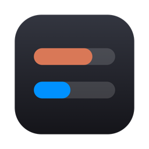
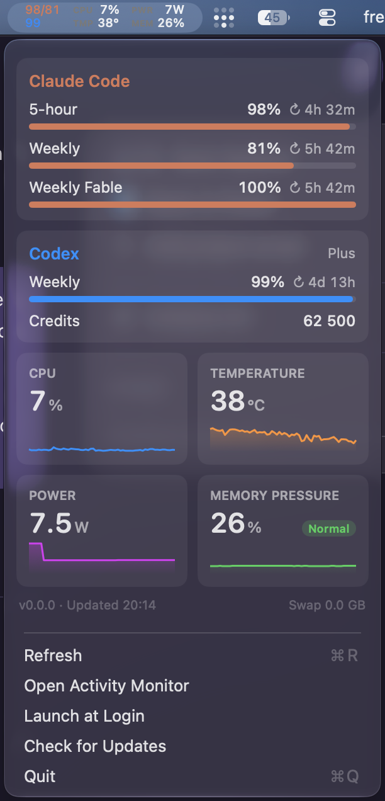

<p align="center">
  
</p>

<h1 align="center">Readout</h1>

<p align="center">
  A compact macOS menu bar readout of your <b>Claude Code</b> and <b>Codex</b> usage limits, plus <b>CPU</b>, <b>temperature</b>, <b>power</b>, and <b>memory pressure</b>.
</p>

<p align="center">
  <a href="https://github.com/hkarlsen06/Readout/releases/latest"></a>
  <a href="https://github.com/hkarlsen06/Readout/releases"></a>
  
  
  
  <a href="LICENSE"></a>
</p>

<p align="center">
  
</p>

Everything fits in one two-row item:

```
98/81   CPU 11%   PWR 16W
99      TMP 40°   MEM 26%
```

- **Orange** is Claude Code (5-hour / weekly % left), **blue** is Codex. When a Codex limit runs out and you have credits, the blue number switches to your credit balance (`62.5k cr`).
- **CPU / TMP** – CPU utilization and SoC die temperature.
- **PWR** – whole-system power draw in watts.
- **MEM** – memory pressure (not RAM used, which is always high on macOS), the same figure `memory_pressure` reports.

Click for per-window usage bars with reset countdowns, plan and credits, two-minute graphs for each system stat, the memory pressure level (normal / warning / critical) and swap in use.

## Install

Download `Readout.zip` from the [latest release](https://github.com/hkarlsen06/Readout/releases/latest), unzip, move `Readout.app` to `/Applications`, and open it. Turn on **Launch at Login** from its menu.

Readout updates itself from GitHub Releases (checked at launch and every 6 hours; updates are only installed if notarized and signed with the author's Developer ID).

Requires macOS 13+. Usage limits need you to be logged in to the `claude` and/or `codex` CLIs. Temperature and power need Apple silicon and a MacBook respectively; otherwise they show `–`.

## How it works

- **Claude Code:** reads the OAuth token Claude Code stores in your Keychain (`Claude Code-credentials`) and calls `api.anthropic.com/api/oauth/usage`.
- **Codex:** reads `~/.codex/auth.json` and calls `chatgpt.com/backend-api/wham/usage`.
- **CPU:** `host_statistics` tick counts, sampled every 2 s.
- **Temperature:** average of the SoC die sensors via the (private) IOKit HID event API.
- **Power:** `SystemLoad` from the battery controller's `PowerTelemetryData`.
- **Memory pressure:** `kern.memorystatus_level` and `kern.memorystatus_vm_pressure_level`.

Tokens never leave your machine except to those endpoints. It never refreshes tokens itself — the CLIs do that — so if a login expires, open the CLI once. The usage endpoints and the temperature API are undocumented and may change. No root or helper tool is needed.

## Build

```sh
./build.sh            # dev build, signed with Developer ID (SIGN_ID=- for ad-hoc)
./release.sh 1.2.3    # build, notarize, staple, tag, and publish a GitHub release
```
